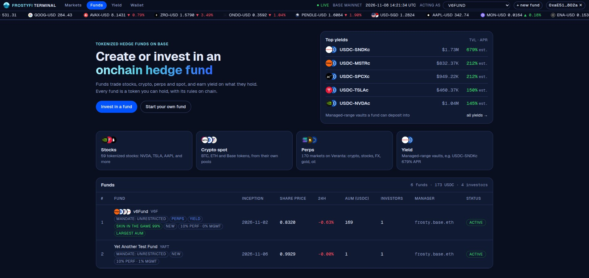
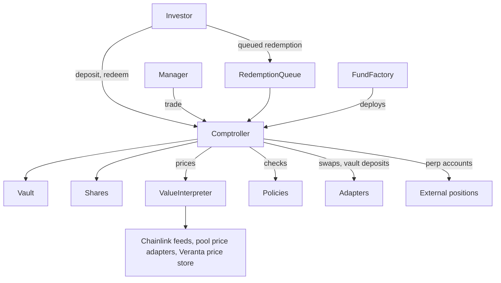

# FrostyFi funds-core

Smart contracts for FrostyFi's onchain funds on Base.

A fund is a vault that a manager trades and investors hold shares in. The manager can trade the fund's assets through approved integrations but can't withdraw them. Investors deposit USDC, receive shares priced from onchain price feeds, and redeem for USDC. Each fund's rules and fee limits are enforced by its contracts.

The contracts are live on Base mainnet in public beta. The terminal is at [frostyfi.fund](https://frostyfi.fund).

[](https://frostyfi.fund)

## Contents

- [How a fund works](#how-a-fund-works)
- [Architecture](#architecture)
- [Design rules](#design-rules)
- [Hard limits](#hard-limits)
- [Roles](#roles)
- [Repository layout](#repository-layout)
- [Build and test](#build-and-test)
- [Deployments](#deployments)
- [Security](#security)
- [License](#license)
- [Acknowledgements](#acknowledgements)

## How a fund works

1. **Create.** Anyone calls `FundFactory.createFund` with a name, a symbol, the denomination asset (USDC), the fees, the deposit timings and a set of policies. The factory deploys three contracts for the fund: a `Comptroller`, a `Vault` and a `Shares` token. Policies are attached at creation; a manager can't remove or loosen them later.
2. **Deposit.** An investor calls `requestDeposit`, which holds their USDC in escrow. After the fund's waiting time (at least one minute), anyone can call `executeDepositRequest`, which mints shares at the share price of that moment. The investor sets the highest share price they accept and can cancel a request that hasn't been executed. A deposit never mints shares in the transaction that requested it.
3. **Trade.** The manager calls `callOnIntegration` with a registered adapter (a swap, a vault deposit) or `callOnExternalPosition` on a registered position type (a perp account). The Comptroller measures what left and entered the Vault, tracks new assets, and runs the fund's policies on the result. A trade that breaks a policy reverts.
4. **Value.** The fund's gross asset value is the sum of its tracked assets and its external positions, each priced through the `ValueInterpreter`. The share price is that value divided by the share supply.
5. **Fees.** The management fee compounds per second. The performance fee is charged on gains above a high-water mark. Both are paid by minting shares to the manager, and both settle before every change in share supply.
6. **Redeem.** A fund with no external position, no pool-priced token and no token whose price can't be read at that moment redeems immediately through `redeemShares`. Any other fund redeems through the `RedemptionQueue`: the investor's shares wait in escrow, the manager raises the USDC, and the request settles at the share price of that moment, oldest first. Every redemption pays the full value of the shares, in USDC.

A queued request has a four-day deadline. Past it the manager's fees stop, the manager can no longer spend the Vault's USDC, and the queue's keeper may sell the fund's holdings into USDC to pay the request. Each of those sales may lose at most 3% against the oracle price.

## Architecture



**Per fund**

| Contract | Role |
|---|---|
| `Comptroller` | The fund's logic: deposits, redemptions, valuation, fees, policies, tracked assets and external positions. |
| `Vault` | Custody. Holds the fund's tokens and releases them only at the Comptroller's call. |
| `Shares` | The fund's share token (ERC-20, 18 decimals). Only the Comptroller mints and burns. |

**Shared**

| Contract | Role |
|---|---|
| `FundFactory` | Deploys funds and keeps the fund registry, the adapter and position-type registries, and the policies every new fund must carry. |
| `ValueInterpreter` | The only price source. Values any registered asset in any other through registered USD feeds. A price older than its asset's heartbeat reverts. |
| `PoolPriceRegistrar` | Lets anyone price a token from its own DEX pool, with no listing step. Owns the `ValueInterpreter`. |
| `RedemptionQueue` | Queued redemptions for every fund: escrow, settlement in order, the deadline and liquidation. |

**Plug-ins**

| Directory | Contents |
|---|---|
| `src/adapters` | Trading integrations: Uniswap v3 and v4, Aerodrome (basic and Slipstream pools), ERC-4626 vaults and FrostyFi's managed liquidity vaults. An adapter never holds funds between calls, and the Comptroller checks every trade by the Vault's balance changes, not by what the adapter reports. |
| `src/policies` | Pass/fail checks run on fund actions: depositor and share-transfer allowlists, deposit size, allowed or blocked assets, concentration, position count, minimum pool liquidity, and a limit on the value lost to trades over time. |
| `src/positions` | External positions. Currently one type: a fund's perp account on Veranta, valued into the fund as spot-equivalent legs at the same oracle prices as its spot holdings. |
| `src/pricing` | Price feeds: pool price adapters (Uniswap v3 and v4, Aerodrome), the Veranta price store and its adapters, and derivative feeds for ERC-4626 and managed liquidity vault shares. |
| `src/protect`, `src/profile` | Small registries with no funds and no permissions: hedge settings read by the keeper, and a fund's public links. |

### Pricing

The `ValueInterpreter` reads three kinds of feed:

- **Chainlink feeds** for major tokens and tokenized stocks.
- **Pool price adapters** for tokens with no feed. A token is priced from its own pool over a 30-minute window: on concentrated-liquidity pools the window is split into five slices and the median is used, so a price moves only once it has held. A pool needs $25,000 of liquidity to be registered and for a fund to buy its token. Under $5,000 of liquidity the token is valued at about zero.
- **The Veranta price store** for perp markets and for tokenized stocks without a Chainlink feed. It stores Pyth-signed prices that anyone can relay; a price must have been confirmed recently to be read.

Vault shares (ERC-4626 and managed liquidity vaults) are priced as derivatives: a share resolves to its underlying tokens, which are priced by the feeds above.

## Design rules

1. **Share prices come from oracle feeds only.** Nothing that values a fund reads a pool's current price or tick.
2. **Deposits are asynchronous.** A request and its execution are separate transactions, so a deposit and a withdrawal can never happen atomically.
3. **A tokenized stock is never priced 1:1 with its underlying share.** Each token has its own feed or its own conversion ratio.
4. **Every asset is explicitly in or out of the fund's value.** There is no silent residue.
5. **Risk parameters have limits in bytecode.** Neither a manager nor the protocol owner can set a value beyond them.
6. **Exits are never blocked by a pause.** A pause, by the manager or by the guardian, stops deposits only. A manager can delay a queued redemption, but only until its deadline.

## Hard limits

These are constants in the deployed bytecode.

| Limit | Value | Where |
|---|---|---|
| Performance fee | at most 30% | `Comptroller.MAX_PERF_FEE_BPS` |
| Management fee | at most about 10% a year | `Comptroller.MAX_MGMT_SCALED_PER_SECOND_RATE` |
| Protocol fee on assets | at most 1% a year | `FundFactory.MAX_PROTOCOL_FEE_BPS` |
| Protocol fee on swaps | at most 0.10% | `ProtocolFeeAdapter.MAX_FEE_BPS` |
| Deposit waiting time | 1 minute to 7 days | `Comptroller.MIN_REQUEST_DURATION_FLOOR`, `MAX_REQUEST_DURATION` |
| Deposit execution window | 15 minutes to 7 days | `Comptroller.MIN_EXECUTION_WINDOW`, `MAX_EXECUTION_WINDOW` |
| Wait after a deposit before its shares can be redeemed or transferred | at most 30 days | `Comptroller.MAX_SHARES_ACTION_TIMELOCK` |
| Tracked assets per fund | 30 | `Comptroller.MAX_TRACKED_ASSETS` |
| External positions per fund | 10 | `Comptroller.MAX_EXTERNAL_POSITIONS` |
| Notice before a fund's settings change | 2 days | `FundFactory.RECONFIGURATION_TIMELOCK` |
| Redemption deadline | 4 days | `RedemptionQueue.DEADLINE` |
| Loss on a liquidation sale | at most 3% against the oracle | `ComptrollerLib.MAX_LIQUIDATION_LOSS_BPS` |
| Pool liquidity to register or buy a token | $25,000 | `PoolPriceRegistrar.MIN_LIQUIDITY_USD` |
| Pool liquidity under which a token is valued at about zero | $5,000 | `PoolPriceAdapterBase.MIN_VALUATION_LIQUIDITY_USD` |
| Price heartbeat | at most 7 days | `ValueInterpreter.MAX_HEARTBEAT` |

On Base mainnet every new fund also carries two protocol policies: the minimum pool liquidity rule above, and a limit of 5% of fund value lost to trades, refilling over 7 days.

## Roles

| Role | Can | Can't |
|---|---|---|
| Fund manager | Trade through registered adapters and position types within the fund's policies. Pause the fund's own deposits. Shut the fund down. Request new settings, which take effect after a 2-day notice. | Withdraw the fund's assets. Remove or loosen a policy. |
| Investor | Deposit, redeem, cancel a pending request. | |
| Protocol owner | Register adapters and position types. Set the protocol fees within their limits. Set the policies new funds must carry. List price feeds. Lift a guardian pause. | Take custody of a fund's assets. Change an existing fund's policies or fees. Pause redemptions. |
| Guardian | Pause a fund's deposits at once. Deregister an adapter or position type at once. | Unpause. Touch redemptions, custody or a fund's settings. |
| Queue keeper | Settle queued redemptions. Liquidate a fund whose redemption is past its deadline, within the loss limit. | Act on a fund that isn't overdue, other than settling. |
| Anyone | Create a fund. Execute a matured deposit request. Register a token's price from its pool. Relay a signed Veranta price. | |

There are no upgradeable proxies. A fix to the Comptroller ships as a new build that applies to new funds; an existing fund moves to it only if its manager requests it, after the 2-day notice.

## Repository layout

```
src/
  core/         FundFactory, Comptroller and its libraries, ValueInterpreter
  fund/         Vault, Shares
  redemption/   RedemptionQueue
  adapters/     trading integrations
  policies/     fund rules
  positions/    external positions (Veranta perp account)
  pricing/      pool price registrar and adapters, Veranta price store, derivative feeds
  protect/      hedge settings registries
  profile/      fund profile registry
  interfaces/   interfaces, with third-party protocols under external/
  libraries/    tick and liquidity math
script/release/ deployment, listing and post-deployment checks for Base mainnet
test/           unit tests, with fork/, invariant/, echidna/ and medusa/ suites
deployments/    address records
```

## Build and test

Requires [Foundry](https://getfoundry.sh). Solidity 0.8.24, EVM version Cancun, OpenZeppelin Contracts 5.x.

```bash
git clone --recurse-submodules https://github.com/FrostyLabsAi/funds-core
cd funds-core
forge build
forge test
```

The fork suites in `test/fork` run against Base mainnet state and skip themselves when no RPC is set, so a passing `forge test` without one says nothing about them. To run them:

```bash
BASE_MAINNET_RPC=<archive RPC URL> forge test --match-path 'test/fork/*'
```

`BASE_FORK_BLOCK` pins the fork to a block. The managed liquidity vault suites read the build output of `funds-yield`, which must be checked out and built next to this repository (`../funds-yield`).

To run everything and fail if any test failed or was skipped:

```bash
BASE_MAINNET_RPC=<archive RPC URL> ./scripts/test-all.sh
```

Fuzzing and static analysis:

```bash
echidna . --contract EchidnaFund --config echidna.yaml
medusa fuzz        # runs until stopped
slither . --filter-paths 'lib/|test/|script/' --exclude-informational --exclude-optimization
```

## Deployments

Base mainnet, chain ID 8453.

| Contract | Address |
|---|---|
| FundFactory | `0x3dce6E26f2eA86Cc07620e82392841F5A5c40f30` |
| ValueInterpreter | `0xDD3462fCCEd430050D2151aad077CA7a7722E922` |
| PoolPriceRegistrar | `0xD607063AfC815423A6E7ad79CF6E42F112b7C340` |
| RedemptionQueue | `0x4E3030D8be82a72E3f551a438F8D20cab50bCA07` |
| VerantaPriceStore | `0xCC04114e1435e970715E133a942e1aEA0BC1E246` |
| VerantaPerpConfig | `0x59Ed5B7251749cB2f1220A32c372779470CE15d4` |

The full record, with every adapter, policy and feed, is [`deployments/base-mainnet-release.json`](deployments/base-mainnet-release.json). The other files in `deployments/` record earlier deployments that are no longer in use.

## Security

The contracts are tested with unit tests, fork tests against Base mainnet state, invariant tests, Echidna and Medusa fuzzing, and Slither.

They have not been audited by a third party. This is beta software: use it at your own risk.

## License

GPL-3.0. `src/libraries/TickMath.sol` and `src/libraries/LiquidityAmounts.sol` are GPL-2.0-or-later, from Uniswap.

## Acknowledgements

The fund architecture follows Melon Protocol v1 and patterns from Enzyme v4 ([enzymefinance/protocol](https://github.com/enzymefinance/protocol)). The contracts build on [OpenZeppelin Contracts](https://github.com/OpenZeppelin/openzeppelin-contracts) and use tick and liquidity math from [Uniswap v3](https://github.com/Uniswap/v3-core).
